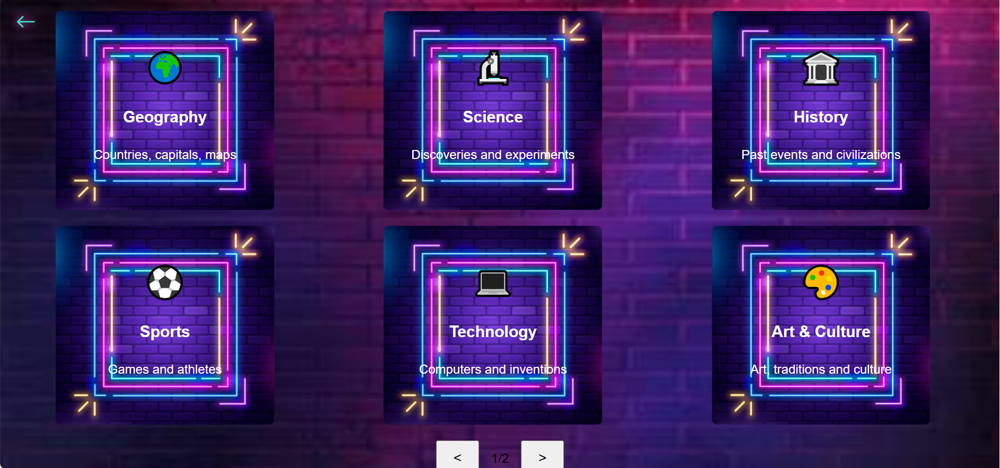
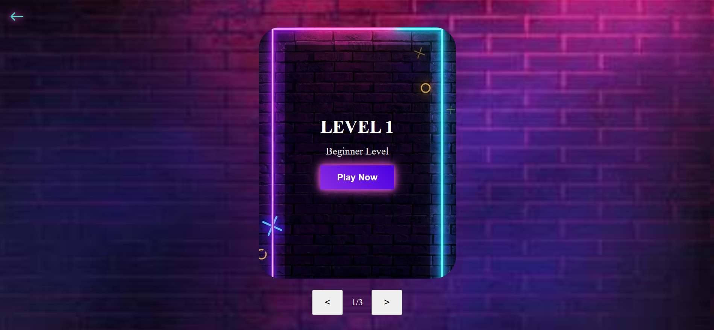
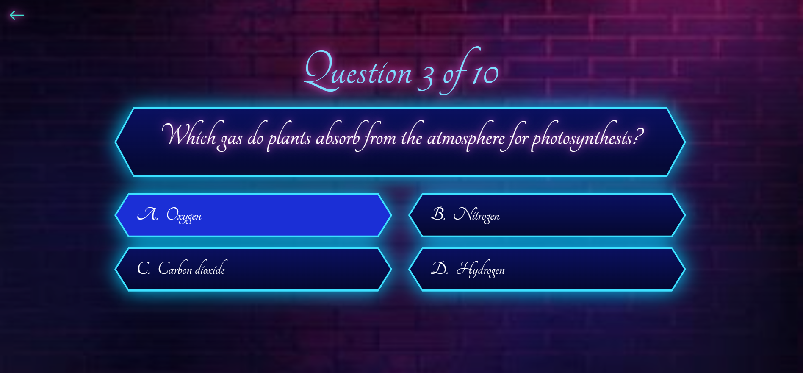
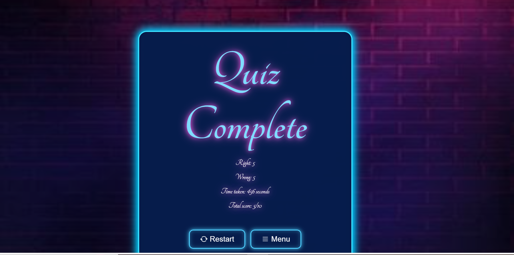
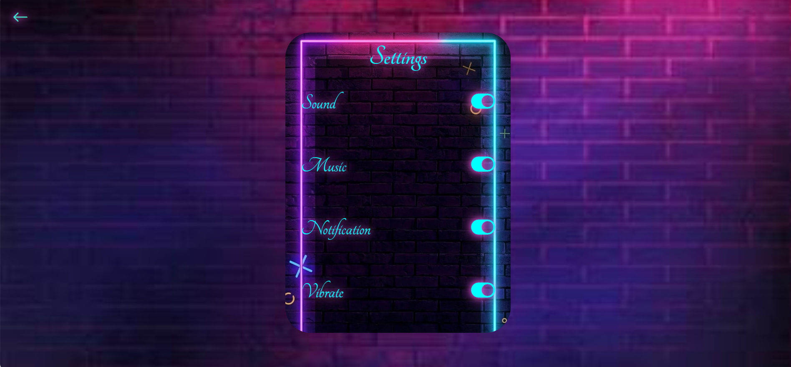

# 🎮 Quiz Time

**Quiz Time** is an interactive, browser-based quiz application built with HTML, CSS, and JavaScript. It allows users to test their general knowledge through multiple-choice questions across a variety of categories.

Choose a category, answer questions, track your score, and challenge yourself!

## ✨ Features

- **12 Quiz Categories:** Geography, Science, History, Sports, Technology, Art & Culture, Literature, Mathematics, Animals, Environment, Food, and Entertainment.
- **120 Questions:** 10 questions in each category.
- **Multiple-Choice Questions:** Four answer options for each question.
- **Instant Feedback:** Visual feedback for correct and incorrect answers.
- **Score Tracking:** View your results after completing a quiz.
- **Time Tracking:** See how long you took to complete the quiz.
- **Player Profile:** Set a username, age, and profile picture.
- **Level Selection:** Beginner, Intermediate, and Advanced level screens.
- **Settings Interface:** Sound, music, notification, and vibration controls.
- **Interactive Navigation:** Move between pages and categories.
- **Restart Option:** Play a quiz again.

## 🛠️ Technologies Used

| Technology | Purpose |
|---|---|
| HTML5 | Application structure |
| CSS3 | Styling and layouts |
| JavaScript | Quiz logic and interactivity |
| JSON | Quiz question database |
| Local Storage | Saving profile information |
| Bootstrap Icons | Interface icons |
| Google Fonts | Typography |

## 📚 Quiz Categories

1. 🌍 Geography
2. 🔬 Science
3. 🏛️ History
4. ⚽ Sports
5. 💻 Technology
6. 🎨 Art & Culture
7. 📚 Literature
8. ➗ Mathematics
9. 🐘 Animals
10. 🌱 Environment
11. 🍕 Food
12. 🎬 Entertainment

## 📁 Project Structure

```text
Quiz_Time/
├── index1.html
├── index2.html
├── categories.html
├── level.html
├── profile.html
├── setting.html
├── menu.html
├── music.html
├── Game1.css
├── Game2.css
├── Game.js
├── game2.js
└── Quiz_question/
    ├── question.html
    ├── Qstyle.css
    ├── script.js
    └── question.json
```

## 🚀 Getting Started

### 1. Clone the repository

```bash
git clone https://github.com/chaithranarendrabhandarkar2004/Quiz_Time.git
```

### 2. Open the project folder

```bash
cd Quiz_Time
```

### 3. Start a local server

If Python is installed, run:

```bash
python -m http.server 8000
```

### 4. Open the application

Visit `http://localhost:8000` in your browser and open `index1.html`.

## 🧠 How the Quiz Works

1. Open the application.
2. Navigate to the level selection screen.
3. Choose a quiz category.
4. Read each question and select an answer.
5. Receive feedback.
6. Continue through the questions.
7. View your final score and completion time.
8. Restart the quiz or return to the menu.

## 💾 Data Storage

Player profile information is saved using browser Local Storage. Quiz questions are stored in `question.json` and loaded using JavaScript.

## 🔮 Future Improvements

- Implement persistent level unlocking.
- Add difficulty-specific question sets.
- Improve notification and vibration functionality.
- Add a leaderboard and quiz history.
- Add more questions and categories.
- Improve mobile and tablet compatibility.

## 👨‍💻 Author

**Chaithra Narendra Bhandarkar**

GitHub: [@chaithranarendrabhandarkar2004](https://github.com/chaithranarendrabhandarkar2004)

---

---

## 📸 Project Screenshots

### 🏠 Welcome Screen


### 🎮 Home Dashboard


### 📚 Quiz Categories


### 🏆 Level Selection


### 👤 Player Profile


### ❓ Quiz Questions


### 🎯 Quiz Results


### ⚙️ Settings


---

⭐ If you find this project interesting, consider giving the repository a star!

**Built with curiosity and a love for learning!**
